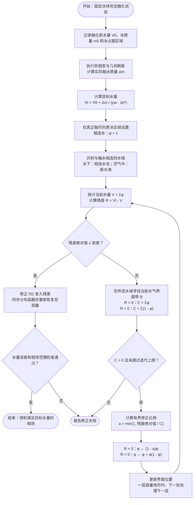

# 参考 Huang 等（2024）的 v3 冰水质量守恒方案

日期：2026-09-22。完整方案尚未接入生产求解器；第 4 节包含历史输出复核及新增 W=5 逐算子收支验证，第 9 节包含固定冰块完全融化的简化算法验证。

研究对象是当前 `iceflow2d_v3`：材料坐标中的融化冰块、平移和转动的锐界边界、世界网格中的水气相场。目标是在没有水流出、没有蒸发的条件下，每个同步时刻都满足冰与液水的总质量守恒。二维质量以单位面外深度的 kg/m 表示，所谓体积对应 m²。

## 1. 结论与推荐路线

可以借鉴论文，但需要同时修改相变、移动几何、相场输运和流动边界四个环节。推荐保留材料网格热模型及多刚体框架，将相变统一为可核算的局部质量通量；采用与几何变化一致的水体积输运，并把密度差造成的收缩纳入流动。全局质量归一化可以作为对照算法，不能替代这套局部收支。

这不是只在 `_collide_phase` 中加一个正源项的修改。尤其在水下，原有回填已经把新露出的格点填成水；在此基础上直接再注入融水，会重复增加水量。

## 2. 论文中可借鉴的内容与适用范围

来源：Huang, Wang, Chai, Shi, *Phase-field-based lattice Boltzmann method for containerless freezing*, Physical Review E 110, 035301 (2024)，DOI：<https://doi.org/10.1103/PhysRevE.110.035301>。方程按用户提供的正式发表 PDF 编号。

- 式 (8)–(13)：由冰水质量守恒导出密度差导致的体积变化。其推导假设固体静止，得到 `div(u) = (1-rho_s/rho_l) partial_t(f_s)`。右端量纲是 1/s，应理解为体积膨胀/收缩率，而不是向冰水系统凭空增加质量。
- 式 (2)：相场方程包含 `phi div(u)`，允许凝聚相外边界随相变引起的体积变化移动。
- 式 (25)–(26)：该项同时进入相场 populations 的源项和半时间步宏观量恢复。
- 式 (33)–(36)：流场源项和压力恢复也随非零散度一起改变。

论文的 `phi` 区分固液混合物和气体，固液之间另用 `f_s` 区分。v3 的 `water_phase` 是有效流体中的水气相场，固体被另外的掩码排除，两者不能直接代换。

此外，v3 是压力型 CM/RM-MRT LBM，论文展示的是另一套具体源项离散。移植时必须重新验证各阶矩、松弛系数和半步修正，不能直接复制 BGK 系数，也不能把压力 populations 的零阶矩当作水质量。

以下移动冰块方程和代码方案是针对本项目的推导，不是论文已经验证过的实现。

## 3. 当前实现中的质量变化路径

| 位置 | 当前行为 | 守恒修改 |
|---|---|---|
| `MovingBodyThermal2D._apply_body_heat_and_phase_change` | 潜热减少材料冰质量，极小残量清零，没有对应液水质量转移 | 输出每个材料单元的实际质量损失，并完整计入融水 |
| `_refresh_fluid_domain` / `_refill_changed_nodes` | 平移、转动、融化共用邻域外推；新水格点并无配对扣减，覆盖格点也未守恒搬出其水 | 分清运动重映射与相变转移；输运广延水量 |
| `_calculate_moving_body_fraction` / `_update_solid_mask` | 双线性覆盖率、多个冰块的 max 和二值阈值共同决定边界 | 新增守恒的体积/容量表示；不能用固体格点个数代替材料冰质量 |
| `_bound_water_phase` | 直接将越界值截到 [0,1] | 用有界且守恒的通量限幅或成对再分配 |
| `_water_aperture_target` / `reporting._capture_snapshot` | `phi <= water_phase_cutoff` 的尾部不计入热水量及输出水量 | 质量口径包含全部相场；热计算阈值不能删除质量 |
| `_collide_momentum` / `_update_pressure` / cut-link | 未包含融化质量通量对应的边界法向速度和体积响应 | 加入与相变、几何相容的流动闭合 |

`phase_momentum_coupling="consistent_flux"` 处理的是已有水气相场的非平流质量通量与动量的一致性，本身不提供冰转水的质量源，也不保证移动掩码或截断守恒。

现有测试明确要求“部分融化不生成液水”“空气中强制融化不生成水”“新露出的水下节点继承热水温度”等行为。这些测试在守恒模式下需要更换物理断言，而不能原样用作验收。

## 4. 已有输出的质量复核

复核对象为 `outputs/four_falling_ice_5s/fields.npz`：W=12、101 个快照、5 s；不是当前 W=5 设置的新仿真。

使用与当前节点模型一致的流体掩码，在内部流体节点上统计全部 `phi`，不采用湿格点阈值，再加四块冰的材料质量。将所有质量除以 `rho_l dx²`，得到水体积等价格数：

**初始水量为什么不是 `450 × 75`：** 这组历史配置的 `boundary_cells=3`，450 × 150 是包含墙层的计算网格。初始化条件为 `i < water_width=447`、`j < water_height=75`，还要排除墙格点。因此实际水区横向是 `i=3,...,446`，共 444 列；纵向是 `j=3,...,74`，共 72 行。四块冰的初始固体节点位于 `j=105,...,134`，不占初始水区。

```text
用户按外部网格尺寸计算的矩形：450 × 75 = 33750
扣除底部墙层：                 450 × 3  = 1350
扣除其余水高内的左右墙层：     6 × 72   = 432
实际初始锐界水区：             33750 - 1350 - 432 = 444 × 72 = 31968
```

表中的“初始液水”来自保存的 `t=0` 场，该场已经完成 2000 次相场预热和初始化处理，并不是刚写入矩形指示函数的瞬间。按全部流体节点积分得到 `31968.071605471498`，比上述几何基准多 `0.071605471498` 格，约为初始几何水量的 `0.000224%`。这应记为初始化净数值偏差；弥散界面使单格 `phi` 可以是小数，但理想的守恒预热本身不应改变总水量。本次只核对几何初值和保存初值，未将这项偏差进一步分解到各个预热算子。

在 `dx=1/3000 m` 下，目前有效内宽为 `444 dx=0.148 m`，水深相对内部底面为 `72 dx=0.024 m`。配置中的 `water_level_m=0.025 m` 表示从计算域原点量起的水面坐标。若要求 0.15 m 和 0.025 m 分别表示容器净内宽和内部水深，需要另行调整网格/墙层的几何映射。

| 量 | 数值 |
|---|---:|
| 初始液水 | 31968.071605 |
| 初始冰质量的水体积等价量 | 3301.199963 |
| 全融后的目标液水 | 35269.271569 |
| 5 s 实际液水 | 35306.132175 |
| 5 s 冰水总质量相对误差 | +0.104512% |
| 101 个快照中的最大绝对总质量误差 | 0.442536%，发生在 0.30 s |

表中各行按以下口径计算。`V_l_cells(t)` 是全部非墙、非冰节点的 `phi` 求和；`m_s_LU,b(t)` 是文件中第 b 块冰的 `body_mass_lattice`，等于其物理质量除以 `rho_l dx²`：

```text
V_l_cells(0) = sum_fluid phi(0) = 31968.071605471498
sum_b m_s_LU,b(0) = 4 × 825.2999908245758 = 3301.1999632983034
                ≈ 4 × 30 × 30 × (917/1000) = 3301.2
M0_equiv = V_l_cells(0) + sum_b m_s_LU,b(0) = 35269.2715687698
V_l_cells(5 s) = sum_fluid phi(5 s) = 35306.13217451493
error(t) = [V_l_cells(t) + sum_b m_s_LU,b(t) - M0_equiv] / M0_equiv
error(5 s) × 100% = +0.104511956458%     （四块冰已全部融尽）
max_saved_times abs(error(t)) × 100% = 0.44253612%
```

已有记录中的液水增长约 10% 不等于冰水总质量误差；这组冰融尽本来就应增加约 3301.2 格液水。末态误差小也不表示每步局部守恒，可能存在不同环节误差的抵消。上述最大值只针对保存的采样时刻，不能代替逐步上界。

初始 `history.csv` 因湿格点阈值少统计了约 3.081629 格相场尾部，因此用它计算的误差会与上述全相场统计不同。新实现首先应统一口径。

### 当前是否已经包含融化体积变化，以及末态为什么接近目标

v3 已经包含“冰材料质量减少 → 覆盖率下降 → 固体掩码退缩 → 新暴露节点回填”的几何变化，但没有按 `delta_V_w=(rho_i/rho_w) delta_V_i` 转换融水，也没有冰水密度差对应的相变收缩源。表中的目标体积是后处理根据初始质量算出的，求解器没有用这个目标约束水量。

`_apply_body_heat_and_phase_change` 只减少材料冰质量；随后 `_refill_changed_nodes` 从持续为流体的邻居外推 `phi`。在纯水中暴露一格，通常填成 `phi=1`，在空气中暴露则通常填成 `phi=0`。因此“没有显式融水质量转移”不等于“输出液水体积不会增加”。水下回填本身就在增加统计中的水量，但没有配对的质量收支。

2026-09-22 用当前生产内核在 CUDA 上做了隔离对照：固定 8×8 冰块，不进行流场推进或相场预热，施加足够的规定热量，依次调用材料相变和几何刷新。水密度统一为 1000 kg/m³。在四个案例中，仅材料相变调用都没有改变水量；几何刷新后的结果如下：

| 冰块位置 | 冰密度 kg/m³ | 实际增加水量/格 | 按冰水质量守恒应增加/格 |
|---|---:|---:|---:|
| 完全在水下 | 500 | 64 | 32 |
| 完全在水下 | 917 | 64 | 58.688 |
| 完全在水下 | 1000 | 64 | 64 |
| 完全在空气中 | 917 | 0 | 58.688 |

这是规定相变的算法隔离检查，不是自然热融化的完整物理验证。它直接表明当前几何回填没有使用固液密度比控制生成水量。冰密度仍会通过材料热容量、刚体质量和运动轨迹间接影响完整算例，但这种间接影响不构成相变质量守恒条件。

对于上表的 W=12 四冰块历史输出：

```text
实际净增水量 = 35306.13217451493 - 31968.071605471498
             = 3338.060569043435 格
守恒要求的增水量 = 3301.1999632983034 格
差值 = 36.860605745132 格
相对理论增水量的误差 = 36.860605745132 / 3301.1999632983034
                    = 1.116582%
相对初始冰水总质量的误差 = 36.860605745132 / 35269.2715687698
                        = 0.104512%
```

回填已经补入与冰几何体积同量级的水，加上固液密度比 0.917 本就接近 1，所以末态并没有缺失全部融水。实际净增水量相当于初始冰体积的约 0.927239 倍，接近理论的 0.917 倍。原有大水池又使总质量误差的百分比小于净增水量误差。

完整运动过程中，新覆盖节点退出水量统计、新暴露节点回填、部分区域与空气接触、移动冰壁的相场反弹修正以及相场限幅/浮点累积都会影响净水量。其中 `_stream` 的移动壁面相场修正使用刚体壁速，不包含由融化质量通量推导的界面退缩速度。现有快照没有记录这些算子的逐步质量收支，因此尚不能把净增水量中的具体差额归因到其中某一项，也不能把末态接近解释为已经模拟出正确的 8.3% 相变收缩。

### 新增 W=5 验证：为什么净增水量不等于 3600 格

按用户要求，用 W=5 重新运行并逐步累计各算子实际改变的水量。默认 `legacy` 路径在约 0.1027 s 失稳；采用项目已有 `consistent_flux` 选项完成 600,000 步、5 s，未启用任何水量校正。四块冰全部融尽，水量从 `31968.099265547` 增至 `35186.546764960`，实际净增加 **3218.447499 格**。这与上面的旧 W=12、3338.060569 格是两次不同设置的结果。

同尺寸四冰块在纯水中保持不动、规定其全部融化的 W=5 隔离对照，确实增加 `3599.999997139` 格水。因此 3600 格的推算适用于新露出节点全部填成纯水的情形。下落融化中，融化刷新净释放 3048 格、运动刷新净释放 552 格；融化回填按邻域 phi 外推，只补入 2800.245886 格，少于填满 3048 格所需的水量。

本次完整算例相对 3600 的差额严格分解为：

```text
3600.000000   初始几何冰体积
 -247.754114  融化新节点回填不足 1 的少补量
  +17.764973  运动启闭与移动壁面修正的合计，减去运动净释放的 552 格
 -151.973262  phi > 1 截回 1 的删水；本次负值截断增水为 0
   +0.409902  碰撞与宏观恢复舍入
=3218.447499  实际净增加
```

最大采样账目闭合误差为 `1.080×10⁻¹⁰` 格，内部流送的净贡献为零。两项主要减量是非纯水回填和非守恒限幅；运动及壁面收支部分抵消了它们。守恒要求增加 `3301.199963` 格，本次实际仍少 `82.752464` 格，冰水总质量误差为 `−0.234630%`。这不能解释为已经实现密度比为 0.917 的相变收缩。

完整算子表、逐时刻收支、隔离对照及复现命令见 [W=5 水量收支核查报告](/home/georgelyu/Repos/ProjectIcy/iceflow2d_v3/research/water_volume_budget_w5_20260922_zh.md)。W=5 的分项数值不能直接套用到旧 W=12 的 261.939431 格差额。

其中融化开格的平均回填 phi 为 `2800.245886 / 3048 = 0.918716`。它与密度比 0.917 接近，但属于不同统计量：浮力平衡约束水下冰体积比例，回填平均值由融化位置和邻域相场加权决定。已有数据能确认没有密度比回填公式，尚不足以定量归因这个接近值。详见[回填平均 phi 与密度比的关系](/home/georgelyu/Repos/ProjectIcy/iceflow2d_v3/research/refill_density_relation_w5_zh.md)。

## 5. 应当满足的守恒关系

### 5.1 总质量及相变转移

定义 `V_l,K` 为世界单元中的实际液水体积，`m_s,a` 为材料单元冰质量：

```text
M_s = sum_a m_s,a
M_l = rho_l sum_K V_l,K
M_total = M_s + M_l
M_total(t) = M_total(0)
```

质量基准应在相场预热和初始化全部结束后记录。若以后允许水通过边界，则要加入边界水质量通量积分。

一次相变子步必须满足：

```text
delta_m_a = m_s,a_before - m_s,a_after >= 0
sum_K delta_V_l,K = sum_a delta_m_a / rho_l
delta_V_s = -sum_a delta_m_a / rho_s
delta_(V_s+V_l) = sum_a delta_m_a (1/rho_l - 1/rho_s)
```

采用当前 `rho_s=917`、`rho_l=1000 kg/m³` 时，1 cm³ 冰融化得到 0.917 cm³ 水，凝聚相总体积减少 0.083 cm³。这里既不是等体积融化，也不是冰水质量减少。

清零的材料残量也必须进入 `delta_m`。若为了能量精度保留残冰而不清零，则质量继续保留在固相。禁止无记录删除。熔尽后的剩余显热也应转移给液水，不能继续丢弃。

### 5.2 移动固体的推广

令 `Gamma >= 0` 为单位世界体积、单位时间内的融化质量；`alpha_s`、`alpha_l` 为真实体积分数；`u_s` 为刚体局部速度。则：

```text
partial_t(alpha_s) + div(alpha_s u_s) = -Gamma/rho_s
partial_t(alpha_l) + div(alpha_l u_l + J_l) = Gamma/rho_l
```

`J_l` 是以共享面通量实现的相场非平流体积通量，封闭边界上不能造成净水量变化。

在各相密度恒定、无额外气相质量源且体积分数和为 1 的模型中，体积平均速度满足：

```text
div(u_volume) = S_v = Gamma (1/rho_l - 1/rho_s)
```

运动问题的相变率应由材料网格的质量减少给出。不能直接把世界网格相邻时刻的 `alpha_s` 差分作为相变率，否则冰块平移、旋转或接触位置修正都会被误判为融化/冻结。

### 5.3 推荐采用与当前锐界相容的界面条件

保留锐界框架时，论文的体积源思想可落实为冰水界面的质量通量条件。令法向 `n` 从冰指向水，`j > 0` 表示单位界面面积、单位时间的融化质量，`V_Gamma,n` 为界面法向速度：

```text
j = rho_s (u_s dot n - V_Gamma,n)
  = rho_l (u_l dot n - V_Gamma,n)

u_l dot n = u_s dot n + j (1/rho_l - 1/rho_s)
```

切向仍可采用无滑移条件。该法向条件使密度差引起的流动与界面退缩相容；体相水仍不可压缩。

推荐先沿此路线改造 cut-link 与几何质量输运。若改用全域弥散固相模型，再采用体积源 `S_v`、论文式相场源和压力修正。两种表示描述同一相变体积效应，不能在同一界面上完整叠加，避免重复计算。

## 6. 具体实现设计

### A. 建立唯一的质量状态和逐算子收支

新增独立的质量诊断模块，记录 `M_s`、`M_l`、`M_total`、实际 `delta_m`、边界质量通量，以及碰撞流送、几何重映射、相变、限幅各自造成的水量变化。主统计不依赖 `water_phase_cutoff`，归约使用 f64。

将液水广延体积与相场统一：每个单元只有一份权威水量，热容量、相场恢复和输出都读取它。若仍保留两种存储，则它们必须满足逐单元同步恒等式，不能由热模块和相场模块独立输运后互相覆盖。

### B. 从材料网格产生守恒的相变通量

在 `_apply_body_heat_and_phase_change` 中输出每个材料单元实际 `delta_m`。映射到世界界面的权重必须非负、对每个供体求和为 1，并按同一位姿进行。多冰块先合并受体容量和质量请求，再统一提交，避免相互覆盖或重复填水。

纯运动阶段 `delta_m=0`。部分融化即使没有触发任何二值格点翻转，也必须产生相应融水；不能等固体格点消失后才计质量。

所有转移均以局部收支完成。局部容量不足时，应通过与速度/压力约束一致的体积通量排开周围流体，或减小耦合子步；不能把溢出的融水丢掉，也不能无条件加到已经 `phi=1` 的单元。

### C. 使运动几何与流体容量一致

新增守恒固相体积 `alpha_s` 和流体容量 `chi=1-alpha_s`，满足：

```text
sum_K alpha_s,K dx² = sum_a m_s,a / rho_s
V_l,K = chi_K phi_K dx²
0 <= V_l,K <= chi_K dx²
```

材料到世界的投影需在平移、旋转后保持该体积恒等式。当前双线性取样与阈值掩码没有这个保证，不能直接换一个积分权重便宣称守恒。

锐界标记仍可用于碰撞、接触和边界定位，但相场和热输运必须识别部分单元的容量、有效面开口和边界扫掠体积。采用保守 ALE/cut-cell 重映射，满足离散几何守恒律：不融化的冰无论怎样平移或旋转，都不能改变全域水量。小容量单元需要合并或受控子步，不能靠清空水量处理稳定性。

`_refill_changed_nodes` 仅重建压力、速度和非平衡分布形状；其相场零阶矩由重映射后的实际水量决定。覆盖节点中的水要通过通量转移，新露出节点从相同收支中获得水，不允许独立外推决定两者质量。

若继续使用相场 LBM，必须把有效容量和边界通量纳入 populations 的演化及恢复，保证链路/面交换成对抵消；这部分需要专门推导，不能仅在原 streaming 之后改 `phi`。若改为有限体积相场输运，则应明确这是保留 Allen–Cahn 模型、改变离散方法，并使动量模块读取同一质量通量。

### D. 实现密度差的流动响应

锐界路线使用 5.3 中的界面质量通量与法向速度，修订边界 streaming/cut-link 及相应动量交换。界面退缩速度、融水生成量和水侧法向速度必须来自同一 `delta_m`。

弥散路线的替代方案则需要一起改相场源、宏观相场恢复、动量源矩和压力恢复，并验证恢复出的连续方程。由于 `water_phase` 的定义与论文不同，应从 `alpha_l=chi phi` 的守恒方程重新导出源项，不能直接把 `phi S_v` 加到当前水相场。

### E. 有界守恒和其他场同步

把 `_bound_water_phase` 改为守恒的通量限幅，或对超额/缺额做局部、成对、受容量约束的再分配。若需要扩大再分配范围，应限制在物理连通的流体区域并记录搬运量。质量误差和累计修正量分别报告，防止大幅校正掩盖输运错误。

相场 populations 的零阶矩必须与实际水量一致，包括采用源项离散时的半步项。密度和动量也必须同步，不能仅改变 `phi` 而留下旧动量分布。

融水初始温度按熔点与剩余热量确定，不能直接继承附近 90°C 热水温度。相变转移的线/角动量使用同一供体质量和材料点刚体速度，并结合界面牵引核对，避免与边界力重复计算。质量验收通过不自动意味着能量、动量已经守恒，应分别报告。

## 7. 时间步与边界条件

第一轮实现使用每个 LBM 步更新热相变，先排除当前 8 步热更新造成的时间分裂歧义。每次耦合子步只使用一次 `delta_m`，在提交后同时更新冰质量、流体容量、水量、相场分布和热状态。

恢复多速率后，采用明确的时间积分和子循环：时间内积分的相变通量必须等于材料实际损失，几何退缩与源项同步。不能立即扣冰后又在后续多个步重复注入同一质量，也不能用未计入水相的隐藏待分配质量解释表面上的守恒。

边界闭合必须明确。当前四面封闭，而凝聚相融化收缩会增加气体空间；在严格不可压缩、无气相源的模型中，全域 `div(u)=S_v` 与四周零法向通量不相容，因为域积分的 `S_v` 不为零。可选处理包括顶部气相压力开边界，或封闭气体的可压缩/平均压力闭合。第一版物理验证推荐顶部通气且不允许液水逃逸；保留封闭上壁的模式则需要单独实现气体闭合。不能靠给整个水域减去平均源项来“修复”这个相容性条件。

这项要求来自本项目边界条件与体积守恒的组合分析，不是把论文的数值验证解释为已证明本项目封闭气体问题。冰水总质量目标不等于要求把空气质量也纳入同一常数密度模型中守恒。

## 8. 实施顺序与验收

1. **质量基线。** 统一全相场水量统计，增加逐算子收支，重放已有输出并跑无相变固定/运动冰块基准，分开测量回填、限幅和浮点累积误差。
2. **守恒几何及传递。** 先实现纯运动时的守恒水量重映射，再实现规定 `delta_m` 的局部相变转移。以一次守恒提交替代原先独立回填。
3. **物理耦合。** 接入密度差界面条件、动量/热同步与气相边界闭合；完成固定冰、运动冰和自由液面的组合验证。
4. **完整算例。** 恢复多冰块、多速率和原有稳定性选项，分别跑单冰和四冰融化，再做时间步、网格及界面宽度收敛。

建议的验收矩阵：

| 算例 | 核心断言 |
|---|---|
| 无相变的平移、旋转及接触位置修正 | 水质量保持，固体材料质量保持，不产生相变源 |
| 等密度固液的规定融化 | `delta_V_l=-delta_V_s`，密度差体积源为零 |
| 917/1000 的规定融化 | 液水增加严格等于失去冰质量/1000，凝聚相体积相应收缩 |
| 空气中受规定热源融化 | 即使没有湿邻格，也不能使质量消失；必须生成液水 |
| 平面三相 Stefan 熔化 | 对比界面位置、液面运动和质量；物理收敛与守恒误差分开评价 |
| 多冰块、近壁及亚网格残冰 | 无重复注入、无越界丢失、末端残量完整转移 |
| 完全融尽后继续运行 | 冰水总质量保持，不再有残留相变源 |
| 四冰块 5 s | 逐步而非只在采样时检查总质量、场有界性和修正量 |

建议以生产全程 `max |M_total/M_total(0)-1| <= 1e-5` 作为第一轮工程门槛，并要求没有单向长期漂移；这是拟定目标，不是已达到的结果。f64 局部传递单元测试应达到与运算规模相符的舍入误差。当前相场为 f32，不能只把统计改成 f64 就承诺机器精度守恒；若长期误差超过门槛，应检查通量对称性并考虑权威水量/相场 populations 的精度。

现有 `iceflow2d` 的体积投影和融水传递代码可作为总量对照，但不能直接视为本方案完成；其全局修正存在非局部输运近似。完整的 Huang 思路在这里应落到相变质量、界面运动、流体输运的一致离散上。

## 9. 64 格固定冰块的简单算法：有界界面水量修正

针对第 4 节的固定 8×8 冰块完全融化实验，可先使用“目标水量 + 同连通水域的界面修正”。这是一种总体质量约束近似，不需要先实现第 6 节的完整 ALE/cut-cell 方案。

### 算法

1. 相变前记录实际水量 `V0` 和材料冰质量；相变后由实际失去的冰质量计算 `V_target = V0 + delta_m/(rho_w dx²)`，这里体积采用格子面积单位。
2. 对这个固定位置、完全融化的试验，将原冰占据的格点作为融水候选区域，先设为纯水。水下试验与原回填相同；空气中试验由此生成一团新水。候选区域是明确融化掉的材料位置，不能泛化为所有运动暴露格点。
3. 识别与融水候选区域相连的水域。水下对应原水池，空气中对应独立的新水滴；修正不跨越不相连的水域。
4. 计算回填/播种后的水量 `V*` 与目标之间的差额，只在上述水域的水气界面带修改 `phi`。内部纯水保持为 1，不通过在冰原位置均匀设 `phi=0.917` 来制造气体混合。

设需要移除水量为 `D=V*-V_target>0`，界面带 `B` 中可移除的总量为 `C=sum_B phi`。当 `D<=C` 时：

```text
phi_new,K = phi_K (1-D/C),   K in B
sum_B (phi_K-phi_new,K) = D
```

需要增加水量 `A=V_target-V*>0` 时，使用剩余容量 `C=sum_B (1-phi)`：

```text
phi_new,K = phi_K + (A/C)(1-phi_K),   K in B
sum_B (phi_new,K-phi_K) = A
```

比例不超过 1，因此更新自动满足 `[0,1]`。若一层容量不足，先耗尽这一层，再处理下一层界面。最后吸收一次 f32 存储舍入残差，并同步相场 populations 的零阶矩及动量平衡部分；从 populations 重新恢复宏观量后再次检查水量。

对于 `rho_i/rho_w=0.917`，先填入 64 格候选水，再移除 `64-58.688=5.312` 格。水下试验的水池界面有 28 格，只需把最上面一层水的相场从 1 调到约 `1-5.312/28=0.810286`；冰原位置仍为纯水。空气中试验则在 8×8 新水滴的 28 个边界格点上做同样的修正，内部 36 格保持为 1，原有水池不变。

### 算法框图

下图对应固定位置、完全融化的验证脚本。体积以格子面积为单位；水下与空气中的区别由融水所在的连通水域决定，不需要手动指定修正远处水池。图中的结束表示水量及相场检查通过，不表示热量或流动瞬态已经验证。



框图源文件：`research/simple_melt_volume_flowchart.mmd`。当前参考实现的主循环容差为 `1e-10` 格，转换为 f32 后的水量验收容差为 `1e-7` 格；容量不足或不收敛时报告失败，验收不通过也不返回成功结果。

### 实现与实际验证

脚本：`benchmarks/check_simple_melt_volume.py`。在仓库根目录执行：

```bash
python -m iceflow2d_v3.benchmarks.check_simple_melt_volume
```

该脚本使用真实 CUDA 相变、几何刷新和分布函数同步内核；界面识别及水量修正是独立的 NumPy/SciPy 参考实现。未修改 `IceFlow2D.step`，未接入正式热状态更新。结果保存在 `outputs/simple_melt_volume/results.json` 和 `comparison.png`。

| 场景 | 原算法增水/格 | 守恒要求/格 | 修正后实际增水/格 | 界面层数 |
|---|---:|---:|---:|---:|
| 水下，冰密度 500 | 64 | 32 | 32.000000000 | 2 |
| 水下，冰密度 917 | 64 | 58.688 | 58.688000023 | 1 |
| 水下，冰密度 1000 | 64 | 64 | 64.000000000 | 0 |
| 空气中，冰密度 917 | 0 | 58.688 | 58.688000023 | 1 |

四例最大水量残差约 `2.34e-8` 格。检查通过：相场保持 `[0,1]`；水下原冰位置保持纯水；独立水滴不改变原水池；populations 恢复后的相场与目标存储逐格一致。另有主机参考检查覆盖需要增水的 1.2 密度比、超出单层容量、不可容纳的目标和没有水气界面的封闭全水域。

每层需要体积/容量归约和一次有界更新，复杂度为 `O(kN)`；此试验的 `k` 不超过 2，无需泊松求解或非线性求根。32×48 网格的四次参考修正调用实测约 0.20–0.32 ms，不含 CPU/GPU 传输、编译和其他求解步骤；这不是正式 GPU 时间步性能基准。正式接入时可将归约和更新搬到设备端，连通域识别则需结合实际几何处理。

后续在 RTX 5090、450×150、W=5 上的独立性能测量中，包含数据往返与分布函数同步的 CPU 参考路径约为 1.51 ms/次；连通区域已知、单层容量足够的 GPU 路径约为 0.125 ms/次。以当前耦合步约 0.629 ms 为基准，每 8 步校正一次时，估算总耗时分别增加约 30% 和 2.5%；GPU 每步校正则约增加 20%。这些是算子计时推算，尚未包含动态连通区域识别，也未接入正式时间步；详见[并行开销测量](/home/georgelyu/Repos/ProjectIcy/iceflow2d_v3/research/melt_volume_projection_performance_zh.md)。


该简化方案已经验证的是固定完整融化后的水量及相场同步。它会即时调整液面或水滴边缘，未求解收缩产生的压力和速度瞬态，也未验证热量守恒、部分融化、运动节点启闭或四冰块长期运行。将其用于正式时间步时，应保留这些限制，并把几何回填修正量与最终总质量残差分别记录。
